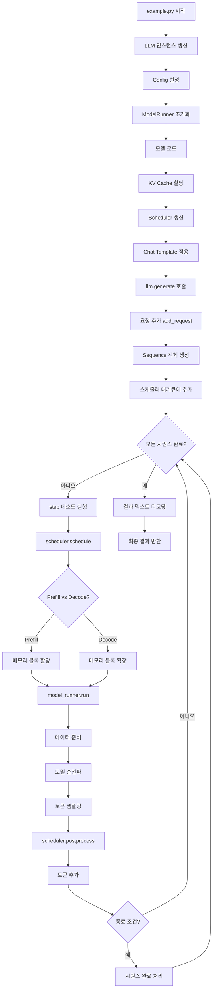

# Nano-vLLM 동작 원리 완전 분석 가이드

이 가이드는 `example.py`가 어떻게 동작하는지 단계별로 상세하게 분석합니다. 
LLM 추론 엔진의 내부 구조와 동작 원리를 완전히 이해할 수 있도록 작성되었습니다.

## 📋 목차

1. [전체 개요](#전체-개요)
2. [Phase 1: 시스템 초기화](#phase-1-시스템-초기화)
3. [Phase 2: 프롬프트 준비](#phase-2-프롬프트-준비)
4. [Phase 3: 텍스트 생성 과정](#phase-3-텍스트-생성-과정)
5. [핵심 컴포넌트 상세 분석](#핵심-컴포넌트-상세-분석)
6. [메모리 관리 시스템](#메모리-관리-시스템)
7. [최적화 기법](#최적화-기법)
8. [전체 흐름도](#전체-흐름도)

---

## 전체 개요

`example.py`는 다음과 같은 3단계로 동작합니다:

```
초기화 → 프롬프트 준비 → 텍스트 생성
```

각 단계에서 일어나는 일들을 하나씩 자세히 살펴보겠습니다.

---

## Phase 1: 시스템 초기화

### 1.1 기본 설정 로드

```python
path = os.path.expanduser("~/huggingface/Qwen3-0.6B/")
tokenizer = AutoTokenizer.from_pretrained(path)
```

**여기서 일어나는 일:**
- 모델 파일이 저장된 경로를 설정
- Hugging Face의 Qwen3 토크나이저를 로드
- 토크나이저는 텍스트 ↔ 토큰 ID 변환을 담당

### 1.2 LLM 인스턴스 생성

```python
llm = LLM(path, enforce_eager=True, tensor_parallel_size=1)
```

이 한 줄이 실행될 때 매우 복잡한 초기화 과정이 진행됩니다:

#### 1.2.1 LLM → LLMEngine 상속 구조

```python
# nanovllm/llm.py
class LLM(LLMEngine):
    pass  # 단순히 LLMEngine을 상속받는 래퍼 클래스
```

#### 1.2.2 LLMEngine 초기화 과정

**Step 1: Config 객체 생성**
```python
config = Config(model, **config_kwargs)
```

Config 객체에서 설정되는 주요 파라미터들:
- `model`: 모델 경로
- `max_num_batched_tokens`: 한 번에 처리할 수 있는 최대 토큰 수 (32768)
- `max_num_seqs`: 동시에 처리할 수 있는 최대 시퀀스 수 (512)
- `max_model_len`: 모델이 처리할 수 있는 최대 컨텍스트 길이 (4096)
- `gpu_memory_utilization`: GPU 메모리 사용률 (0.9 = 90%)
- `tensor_parallel_size`: 텐서 병렬 처리 크기 (1)
- `enforce_eager`: CUDA Graph 사용 여부 (True = 사용 안함)
- `kvcache_block_size`: KV 캐시 블록 크기 (256)

**Step 2: Tensor Parallel 설정**
```python
for i in range(1, config.tensor_parallel_size):
    # tensor_parallel_size=1이므로 이 루프는 실행되지 않음
    process = ctx.Process(target=ModelRunner, args=(config, i, event))
```

현재 설정에서는 `tensor_parallel_size=1`이므로 추가 프로세스는 생성되지 않습니다.

**Step 3: ModelRunner 생성**
```python
self.model_runner = ModelRunner(config, 0, self.events)
```

ModelRunner는 실제 모델 추론을 담당하는 핵심 컴포넌트입니다.

**Step 4: Tokenizer 설정**
```python
self.tokenizer = AutoTokenizer.from_pretrained(config.model, use_fast=True)
config.eos = self.tokenizer.eos_token_id
```

**Step 5: Scheduler 생성**
```python
self.scheduler = Scheduler(config)
```

Scheduler는 시퀀스 스케줄링과 메모리 관리를 담당합니다.

#### 1.2.3 ModelRunner 초기화 상세

ModelRunner가 초기화될 때 다음과 같은 과정이 진행됩니다:

**Step 1: CUDA 환경 설정**
```python
dist.init_process_group("nccl", "tcp://localhost:2333", world_size=1, rank=0)
torch.cuda.set_device(0)
torch.set_default_dtype(hf_config.torch_dtype)  # 보통 bfloat16
torch.set_default_device("cuda")
```

**Step 2: 모델 로드**
```python
self.model = Qwen3ForCausalLM(hf_config)
load_model(self.model, config.model)
```

여기서 실제 Qwen3 모델이 GPU 메모리에 로드됩니다.

**Step 3: Sampler 생성**
```python
self.sampler = Sampler()
```

Sampler는 logits에서 다음 토큰을 선택하는 역할을 합니다.

**Step 4: KV Cache 할당**
```python
self.allocate_kv_cache(config.gpu_memory_utilization)
```

KV Cache는 이전에 계산된 Key와 Value 벡터를 저장하여 중복 계산을 방지합니다.

**Step 5: CUDA Graph 설정 (선택적)**
```python
if not self.enforce_eager:
    self.capture_cudagraph()
```

현재 설정에서는 `enforce_eager=True`이므로 CUDA Graph는 사용되지 않습니다.

#### 1.2.4 Scheduler 초기화

```python
class Scheduler:
    def __init__(self, config: Config):
        self.max_num_seqs = config.max_num_seqs
        self.max_num_batched_tokens = config.max_num_batched_tokens
        self.eos = config.eos
        self.block_manager = BlockManager(config.num_kvcache_blocks, config.kvcache_block_size)
        self.waiting = deque()  # 대기 중인 시퀀스들
        self.running = deque()  # 실행 중인 시퀀스들
```

BlockManager는 메모리를 256 토큰 단위의 블록으로 관리합니다.

---

## Phase 2: 프롬프트 준비

### 2.1 기본 프롬프트 정의

```python
prompts = [
    "introduce yourself",
    "list all prime numbers within 100",
]
```

### 2.2 Chat Template 적용

```python
prompts = [
    tokenizer.apply_chat_template(
        [{"role": "user", "content": prompt}],
        tokenize=False,
        add_generation_prompt=True,
        enable_thinking=True
    )
    for prompt in prompts
]
```

**여기서 일어나는 일:**
- 일반 텍스트가 Qwen3의 대화 형식으로 변환됩니다
- `tokenize=False`: 토큰화하지 않고 문자열로 반환
- `add_generation_prompt=True`: 모델이 응답을 생성할 수 있도록 프롬프트 끝에 특별한 토큰 추가
- `enable_thinking=True`: 모델이 추론 과정을 거칠 수 있도록 설정

**변환 예시:**
```
"introduce yourself" 
→ "<|im_start|>user\nintroduce yourself<|im_end|>\n<|im_start|>assistant\n"
```

### 2.3 Sampling Parameters 설정

```python
sampling_params = SamplingParams(temperature=0.6, max_tokens=256)
```

- `temperature=0.6`: 창의성 조절 (0=결정적, 1=무작위적)
- `max_tokens=256`: 최대 생성 토큰 수

---

## Phase 3: 텍스트 생성 과정

이제 가장 핵심인 `llm.generate(prompts, sampling_params)` 호출 과정을 분석해보겠습니다.

### 3.1 Generate 메소드 시작

```python
def generate(self, prompts, sampling_params, use_tqdm=True):
    # Step 1: 진행 상황 표시를 위한 progress bar 설정
    if use_tqdm:
        pbar = tqdm(total=len(prompts), desc="Generating", dynamic_ncols=True)
    
    # Step 2: sampling_params를 리스트로 변환 (각 프롬프트마다 하나씩)
    if not isinstance(sampling_params, list):
        sampling_params = [sampling_params] * len(prompts)
```

### 3.2 요청 추가 단계

```python
for prompt, sp in zip(prompts, sampling_params):
    self.add_request(prompt, sp)
```

#### 3.2.1 add_request 상세 과정

```python
def add_request(self, prompt: str, sampling_params: SamplingParams):
    # Step 1: 문자열을 토큰 ID로 변환
    if isinstance(prompt, str):
        prompt = self.tokenizer.encode(prompt)
    
    # Step 2: Sequence 객체 생성
    seq = Sequence(prompt, sampling_params)
    
    # Step 3: 스케줄러의 대기 큐에 추가
    self.scheduler.add(seq)
```

#### 3.2.2 Sequence 객체 생성

```python
class Sequence:
    def __init__(self, token_ids: list[int], sampling_params: SamplingParams):
        self.seq_id = next(Sequence.counter)  # 고유 ID 할당
        self.status = SequenceStatus.WAITING  # 초기 상태: 대기 중
        self.token_ids = copy(token_ids)      # 프롬프트 토큰들
        self.last_token = token_ids[-1]       # 마지막 토큰
        self.num_tokens = len(self.token_ids) # 총 토큰 수
        self.num_prompt_tokens = len(token_ids) # 프롬프트 토큰 수
        self.num_cached_tokens = 0            # 캐시된 토큰 수
        self.block_table = []                 # 메모리 블록 테이블
        self.temperature = sampling_params.temperature
        self.max_tokens = sampling_params.max_tokens
        self.ignore_eos = sampling_params.ignore_eos
```

### 3.3 메인 생성 루프

```python
outputs = {}
while not self.is_finished():
    t = perf_counter()
    output, num_tokens = self.step()
    # ... 성능 측정 및 progress bar 업데이트 ...
```

여기서 `self.step()`이 핵심입니다. 각 스텝에서 다음이 일어납니다:

#### 3.3.1 Step 메소드 상세

```python
def step(self):
    # Step 1: 스케줄링 - 어떤 시퀀스들을 처리할지 결정
    seqs, is_prefill = self.scheduler.schedule()
    
    # Step 2: 모델 실행 - 실제 추론 수행
    token_ids = self.model_runner.call("run", seqs, is_prefill)
    
    # Step 3: 후처리 - 생성된 토큰을 시퀀스에 추가하고 상태 업데이트
    self.scheduler.postprocess(seqs, token_ids)
    
    # Step 4: 완료된 시퀀스들 반환
    outputs = [(seq.seq_id, seq.completion_token_ids) for seq in seqs if seq.is_finished]
    num_tokens = sum(len(seq) for seq in seqs) if is_prefill else -len(seqs)
    return outputs, num_tokens
```

---

## 핵심 컴포넌트 상세 분석

### 4.1 Scheduler.schedule() - 스케줄링 단계

스케줄러는 두 가지 모드로 동작합니다:

#### 4.1.1 Prefill 단계 (첫 번째 실행)

```python
# prefill 단계
scheduled_seqs = []
num_seqs = 0
num_batched_tokens = 0

while self.waiting and num_seqs < self.max_num_seqs:
    seq = self.waiting[0]
    
    # 메모리와 토큰 한계 확인
    if (num_batched_tokens + len(seq) > self.max_num_batched_tokens or 
        not self.block_manager.can_allocate(seq)):
        break
    
    # 메모리 블록 할당
    self.block_manager.allocate(seq)
    
    # 시퀀스 상태 변경: WAITING → RUNNING
    seq.status = SequenceStatus.RUNNING
    self.waiting.popleft()
    self.running.append(seq)
    scheduled_seqs.append(seq)

if scheduled_seqs:
    return scheduled_seqs, True  # True = Prefill 모드
```

**Prefill 단계에서 일어나는 일:**
- 대기 중인 새로운 시퀀스들을 배치로 선택
- 각 시퀀스의 전체 프롬프트를 한 번에 처리
- 메모리 블록을 할당하여 KV Cache 공간 확보
- 병렬로 여러 시퀀스를 동시에 처리 가능

#### 4.1.2 Decode 단계 (이후 실행들)

```python
# decode 단계
while self.running and num_seqs < self.max_num_seqs:
    seq = self.running.popleft()
    
    # 메모리 블록 확장 가능 여부 확인
    while not self.block_manager.can_append(seq):
        if self.running:
            self.preempt(self.running.pop())  # 다른 시퀀스 중단
        else:
            self.preempt(seq)  # 현재 시퀀스 중단
            break
    else:
        self.block_manager.may_append(seq)  # 블록 확장
        scheduled_seqs.append(seq)

return scheduled_seqs, False  # False = Decode 모드
```

**Decode 단계에서 일어나는 일:**
- 실행 중인 시퀀스들에서 다음 토큰을 하나씩 생성
- 메모리 부족 시 일부 시퀀스를 중단(preempt)하고 나중에 재개
- 각 시퀀스마다 하나의 토큰만 처리

### 4.2 ModelRunner.run() - 모델 실행 단계

#### 4.2.1 데이터 준비

**Prefill 모드:**
```python
def prepare_prefill(self, seqs: list[Sequence]):
    input_ids = []
    positions = []
    cu_seqlens_q = [0]  # 누적 시퀀스 길이 (query)
    cu_seqlens_k = [0]  # 누적 시퀀스 길이 (key)
    slot_mapping = []   # KV Cache 슬롯 매핑
    
    for seq in seqs:
        seqlen = len(seq)
        # 캐시되지 않은 토큰들만 추가
        input_ids.extend(seq[seq.num_cached_tokens:])
        positions.extend(list(range(seq.num_cached_tokens, seqlen)))
        
        # 배치 처리를 위한 메타데이터 설정
        seqlen_q = seqlen - seq.num_cached_tokens
        seqlen_k = seqlen
        cu_seqlens_q.append(cu_seqlens_q[-1] + seqlen_q)
        cu_seqlens_k.append(cu_seqlens_k[-1] + seqlen_k)
        
        # KV Cache 슬롯 매핑 생성
        for i in range(seq.num_cached_blocks, seq.num_blocks):
            start = seq.block_table[i] * self.block_size
            if i != seq.num_blocks - 1:
                end = start + self.block_size
            else:
                end = start + seq.last_block_num_tokens 
            slot_mapping.extend(list(range(start, end)))
```

**Decode 모드:**
```python
def prepare_decode(self, seqs: list[Sequence]):
    input_ids = []
    positions = []
    slot_mapping = []
    context_lens = []
    
    for seq in seqs:
        input_ids.append(seq.last_token)      # 마지막 토큰만
        positions.append(len(seq))            # 현재 위치
        context_lens.append(len(seq))         # 컨텍스트 길이
        # KV Cache에서 새 토큰이 저장될 위치
        slot_mapping.append(seq.block_table[-1] * self.block_size + 
                          seq.last_block_num_tokens - 1)
```

#### 4.2.2 모델 추론

```python
@torch.inference_mode()
def run_model(self, input_ids: torch.Tensor, positions: torch.Tensor, is_prefill):
    if is_prefill or self.enforce_eager or input_ids.size(0) > 512:
        # Eager 모드: 직접 모델 실행
        return self.model.compute_logits(self.model(input_ids, positions))
    else:
        # CUDA Graph 모드 (현재 설정에서는 사용되지 않음)
        # ...
```

**모델 순전파 과정:**
1. **Embedding**: 토큰 ID → 벡터 표현
2. **Transformer Layers**: 여러 층의 self-attention과 MLP
3. **Output Projection**: 숨겨진 상태 → 어휘 크기의 logits

#### 4.2.3 토큰 샘플링

```python
def run(self, seqs: list[Sequence], is_prefill: bool):
    # 데이터 준비
    input_ids, positions = (self.prepare_prefill(seqs) if is_prefill 
                           else self.prepare_decode(seqs))
    
    # 샘플링 파라미터 준비
    temperatures = self.prepare_sample(seqs) if self.rank == 0 else None
    
    # 모델 실행
    logits = self.run_model(input_ids, positions, is_prefill)
    
    # 토큰 샘플링
    token_ids = self.sampler(logits, temperatures).tolist() if self.rank == 0 else None
    
    return token_ids
```

**Sampler 동작:**
```python
def forward(self, logits: torch.Tensor, temperatures: torch.Tensor):
    logits = logits.to(torch.float)
    greedy_tokens = logits.argmax(dim=-1)  # 가장 확률 높은 토큰
    
    # Temperature scaling
    logits.div_(temperatures.unsqueeze(dim=1))
    probs = torch.softmax(logits, dim=-1, dtype=torch.float)
    
    # Gumbel sampling (확률적 샘플링)
    sample_tokens = probs.div_(torch.empty_like(probs).exponential_(1)).argmax(dim=-1)
    
    # Temperature가 0이면 greedy, 아니면 sampling
    return torch.where(temperatures == 0, greedy_tokens, sample_tokens)
```

### 4.3 Scheduler.postprocess() - 후처리 단계

```python
def postprocess(self, seqs: list[Sequence], token_ids: list[int]):
    for seq, token_id in zip(seqs, token_ids):
        # 생성된 토큰을 시퀀스에 추가
        seq.append_token(token_id)
        
        # 종료 조건 확인
        if ((not seq.ignore_eos and token_id == self.eos) or 
            seq.num_completion_tokens == seq.max_tokens):
            # 시퀀스 완료 처리
            seq.status = SequenceStatus.FINISHED
            self.block_manager.deallocate(seq)  # 메모리 해제
            self.running.remove(seq)            # 실행 큐에서 제거
```

---

## 메모리 관리 시스템

### 5.1 Paged Attention 개념

Nano-vLLM은 **Paged Attention**이라는 혁신적인 메모리 관리 기법을 사용합니다:

```
전체 시퀀스: [토큰1, 토큰2, ..., 토큰1000]
              ↓
블록 단위로 분할: [블록1: 토큰1-256] [블록2: 토큰257-512] [블록3: 토큰513-768] [블록4: 토큰769-1000]
```

각 블록은 256개의 토큰을 저장할 수 있습니다.

### 5.2 Block Manager 동작

#### 5.2.1 블록 할당

```python
def allocate(self, seq: Sequence):
    for i in range(seq.num_blocks):
        token_ids = seq.block(i)  # i번째 블록의 토큰들
        h = self.compute_hash(token_ids, h)  # 블록 해시 계산
        
        # 캐시에서 동일한 블록 찾기
        block_id = self.hash_to_block_id.get(h, -1)
        if block_id == -1 or self.blocks[block_id].token_ids != token_ids:
            # 캐시 미스: 새 블록 할당
            block_id = self.free_block_ids[0]
            block = self._allocate_block(block_id)
        else:
            # 캐시 히트: 기존 블록 재사용
            seq.num_cached_tokens += self.block_size
            block = self.blocks[block_id]
            block.ref_count += 1
        
        seq.block_table.append(block_id)
```

#### 5.2.2 Prefix Caching

동일한 프롬프트 접두사를 가진 시퀀스들은 블록을 공유합니다:

```
시퀀스 1: "안녕하세요. 오늘 날씨가 어떤가요?"
시퀀스 2: "안녕하세요. 오늘 뭐 하세요?"

공통 부분: "안녕하세요. 오늘"  ← 이 부분의 KV Cache를 공유
```

### 5.3 KV Cache 구조

```python
# KV Cache 텐서 구조
self.kv_cache = torch.zeros(
    2,                           # K와 V
    hf_config.num_hidden_layers, # 레이어 수
    config.num_kvcache_blocks,   # 블록 수
    self.block_size,            # 블록 크기 (256)
    num_kv_heads,               # KV 헤드 수
    hf_config.head_dim          # 헤드 차원
)
```

이 구조를 통해 각 블록의 Key와 Value를 효율적으로 저장하고 접근할 수 있습니다.

---

## 최적화 기법

### 6.1 Flash Attention

Flash Attention은 메모리 효율적인 어텐션 계산을 위한 기법입니다:

```python
if context.is_prefill:
    # Prefill: Variable-length Flash Attention
    o = flash_attn_varlen_func(
        q, k, v,
        max_seqlen_q=context.max_seqlen_q,
        cu_seqlens_q=context.cu_seqlens_q,
        max_seqlen_k=context.max_seqlen_k, 
        cu_seqlens_k=context.cu_seqlens_k,
        softmax_scale=self.scale,
        causal=True,
        block_table=context.block_tables
    )
else:
    # Decode: KV Cache를 사용한 Flash Attention
    o = flash_attn_with_kvcache(
        q.unsqueeze(1), k_cache, v_cache,
        cache_seqlens=context.context_lens,
        block_table=context.block_tables,
        softmax_scale=self.scale,
        causal=True
    )
```

### 6.2 Batched Processing

여러 시퀀스를 동시에 처리하여 GPU 활용률을 극대화합니다:

```
단일 처리: [시퀀스1] → [시퀀스2] → [시퀀스3]  (순차적)
배치 처리: [시퀀스1, 시퀀스2, 시퀀스3]        (병렬)
```

### 6.3 CUDA Graph (선택적)

반복되는 GPU 연산을 그래프로 캡처하여 오버헤드를 줄입니다:

```python
# 그래프 캡처
with torch.cuda.graph(graph, self.graph_pool):
    outputs[:bs] = self.model(input_ids[:bs], positions[:bs])

# 그래프 재실행 (매우 빠름)
graph.replay()
```

현재 설정(`enforce_eager=True`)에서는 사용되지 않지만, 프로덕션 환경에서는 성능 향상에 크게 기여합니다.

---

## 전체 흐름도



---

## 핵심 개념 정리

### 시퀀스 (Sequence)
- 하나의 프롬프트와 그에 대한 응답을 나타내는 단위
- 상태: WAITING → RUNNING → FINISHED

### 블록 (Block)
- 256개의 토큰을 저장하는 메모리 단위
- Prefix Caching을 통해 여러 시퀀스가 공유 가능

### Prefill vs Decode
- **Prefill**: 전체 프롬프트를 한 번에 처리 (병렬)
- **Decode**: 토큰을 하나씩 생성 (순차)

### KV Cache
- 이전에 계산된 Key, Value 벡터를 저장
- 중복 계산을 방지하여 속도 향상

### 스케줄링
- 메모리 제약 하에서 여러 시퀀스를 효율적으로 처리
- 필요시 시퀀스를 중단(preempt)하고 나중에 재개

이 가이드를 통해 Nano-vLLM의 동작 원리를 완전히 이해할 수 있습니다. 각 컴포넌트가 어떻게 상호작용하여 효율적인 LLM 추론을 가능하게 하는지 파악할 수 있습니다. 
